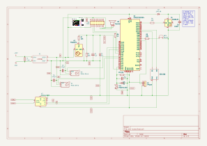

# STM-Auto — SWEE.BRZ Oil Monitor

[](https://github.com/raphaeltournafond/STM-Auto/actions/workflows/ci.yml)

Firmware for an oil **temperature** and **pressure** monitor on an STM32F103C8T6 "Blue Pill",
built with PlatformIO + the Arduino-STM32 core. It reads the two sensors, regulates oil temperature
by opening/closing **twin flap servos**, raises tiered alerts, and shows live status on a 128×64
SSD1306 OLED.

The full behavioural specification (life phases, the priority-ordered situation matrix, adaptive
pressure floors, hysteresis, acknowledgement and voice messages) lives in
[`DECISION_MATRIX.md`](DECISION_MATRIX.md).

## Features

- **Dual sensing** — oil temperature (resistance → °C) and pressure (voltage → bar), via
  piecewise-linear sensor scales.
- **Thermal regulation** — twin flap servos driven in tandem, with temperature hysteresis
  (open 92 °C / close 85 °C) to avoid chatter.
- **Situation decision matrix** — every cycle picks the single highest-priority situation
  (sensor faults → stop-engine → low pressure → overpressure → overheat → normal bands) and drives
  the outputs accordingly, including an **adaptive low-pressure floor** that depends on the
  temperature band.
- **Fail-safes** — flap defaults open on any doubt; sensor faults are detected on the raw signal
  (resistance / voltage) before conversion.
- **Status display** — temperature, pressure, flap state and alert banner on the OLED (alternating
  between simultaneous alarms, raw Ω / V on a sensor fault), plus an onboard backup alert LED.
- **Views + carousel** — one touch button: a tap acknowledges a pending alert; otherwise a tap
  shows the next view (main gauges, temperature trend, pressure trend with the alarm floor, session
  stats, diagnostics) and a long press (≥ 1.5 s) toggles a 5 s carousel.
- **Self-recovering** — hardware watchdog from power-on; a failed start-up self-test never blocks
  monitoring for more than 10 s.
- **Telemetry + calibration** — a CSV line (`T,…`) every 500 ms on the debug serial; a script
  turns logged drives into vehicle-specific oil-pressure alarm floors (see Calibration).
- **Tested** — pure decision logic is unit-tested on the host and gated by CI.

## Hardware

- **MCU:** STM32F103C8T6 "Blue Pill"
- **Display:** SSD1306 OLED 128×64 (I²C)
- **Programmer:** ST-Link (`upload_protocol = stlink`)

Pin map (source of truth: [`src/pins.h`](src/pins.h)):

| Function | Pin(s) | Function | Pin(s) |
|---|---|---|---|
| Pressure sensor | `PA0` | Buzzer (`tone()` → TIM3) | `PB6` |
| Temperature sensor | `PA1` | OLED SCL / SDA (I2C2) | `PB10` / `PB11` |
| Flap servos ×2 (`Servo` → TIM2) | `PA6` / `PA7` | WS2812B RGB LED (SPI2 MOSI; PB13/PB14 reserved) | `PB15` |
| MP3 module (USART1) | `PA9` / `PA10` | Onboard backup LED | `PC13` |
| CAN RX / TX | `PA11` / `PA12` | ACK / view touch button | `PB5` |
| Debug Serial (USART2) | `PA2` / `PA3` | | |

Per-peripheral wiring decisions (supply rails, level handling, supporting parts) are documented in
[`kicad/stm-auto/WIRING.md`](kicad/stm-auto/WIRING.md).

## Getting started

Requires [PlatformIO](https://platformio.org/).

```bash
pio run -e bluepill_f103c8            # build firmware
pio run -e bluepill_f103c8 -t upload  # flash via ST-Link
pio device monitor -b 115200          # serial monitor @ 115200 baud
pio test -e native                    # run unit tests on the host (no hardware)
pio run -t clean                      # clean
```

Library dependencies (auto-installed, pinned in `platformio.ini`): Adafruit SSD1306 + GFX + BusIO
(firmware), Unity (tests).

`pio test -e native` needs a host C/C++ compiler (gcc). On Windows without one, run
`scripts\test-native-msvc.cmd` instead: it builds and runs the same suites with MSVC (Visual Studio
Build Tools, C++ workload; run `pio pkg install -e native` once to fetch Unity).

## Architecture

- **`lib/`** — **pure, Arduino-free** logic: `decision/` (situation matrix, hysteresis, interpolation,
  sensor conversions), `ws2812/` (WS2812B pixel → SPI byte encoding), `buzzer/` (alert patterns +
  envelope), `ack/` (acknowledge state machine), `voice/` (MP3 mapping + DFPlayer frames + reply
  parser), `lifecycle/` (INIT self-test helpers), `gauge/` (gauge scales), `screen/` (alarm
  alternation, layout, raw-value formatting), `run/` (the whole RUN decision tick), `button/`
  (tap / long press / ACK gestures), `views/` (views + carousel) and `trend/` (graph history,
  session stats). State is
  passed in as parameters, so it builds and runs natively and is fully unit-testable.
- **`src/main.cpp`** — owns all hardware I/O (servos, OLED, ADC, LEDs, SPI, serial) and the evolving
  state, sampling the sensors across each ~200 ms loop and calling `runTick()`.

```
src/            firmware (main.cpp, pins.h)
lib/            pure libraries — unit-tested
test/           Unity test suites (native)
scripts/        MSVC test runner, telemetry analysis / calibration, build helpers
sounds/         MP3 voice prompts for the DFPlayer SD card (§7)
kicad/stm-auto/ schematic, PCB, wiring notes
```

## Tests & CI

The pure decision logic has a host-native test suite (Unity):

```bash
pio test -e native
```

[GitHub Actions](.github/workflows/ci.yml) runs the unit tests and the firmware build on every pull
request and on pushes to `main`, and reports flash / RAM usage in the job summary.

## Calibration (oil-pressure floors)

The low-pressure alarm floors (`DECISION_MATRIX.md` §4) ship with generic idle-type values. They
can be raised to match your engine, oil and sensor position from logged drives. They are never
lowered: the generic values are a hard minimum, enforced at compile time.

1. **Record.** Connect a 3.3 V USB-serial adapter to the debug UART (`PA2` TX / `PA3` RX + GND), or
   a serial-to-microSD logger on the same pins, and log at 115200 baud, e.g.:

   ```bash
   pio device monitor -b 115200 --filter log2file
   ```

   Each line is `T,t_ms,ohm,degC,volt,bar,situation,flap,ack` (every 500 ms); `#` lines give the
   firmware revision and the floors in use (repeated every minute). Log a few drives on a
   **healthy engine** with the oil you normally run: cold start, warm idle, and a **hot idle right
   after a sustained drive** (the lowest pressure the engine sees). Two minutes of data per
   temperature band is the minimum.
2. **Analyse.**

   ```bash
   python scripts/analyze_log.py logs/*.log --plot calib.png
   ```

   Prints pressure statistics per 10 °C, the hot-idle pressure (P5) per §4 band, overpressure
   margin and time spent hot, and proposes `pressCritical[]` / `pressRearm[]` (alarm at 50 % of
   P5 by default, `--alarm-ratio` to change). `--plot` needs matplotlib.
3. **Apply.** Review the numbers and the plot, then `--apply` writes the floors into
   `lib/decision/decision.cpp` (or edit them by hand). Run the tests, rebuild, flash, and open a PR.

Re-run after an oil change to a different viscosity. Learning is deliberately not continuous: it
would hide slow wear.

## Status

**Implemented:** `BOOT→INIT→RUN` life phases with self-tests incl. the MP3 SD card (§2), watchdog,
temperature + pressure
reading, twin-servo thermal regulation with hysteresis, the full situation decision matrix with
adaptive low-pressure floor, OLED status display, WS2812B RGB alert indicator (off/yellow/red) with
onboard backup LED, buzzer alert patterns, ACK touch button (mutes sound, §6), multi-alarm display
alternation, switchable views with trend graphs + carousel (§10), MP3 voice prompts (§7), serial telemetry, native tests + CI.

**Wired but not yet coded** (pins assigned, schematic complete): CAN / engine-RPM input. See
`DECISION_MATRIX.md` for the roadmap.

## Schematics

The KiCad project is [available here](kicad/stm-auto/).


